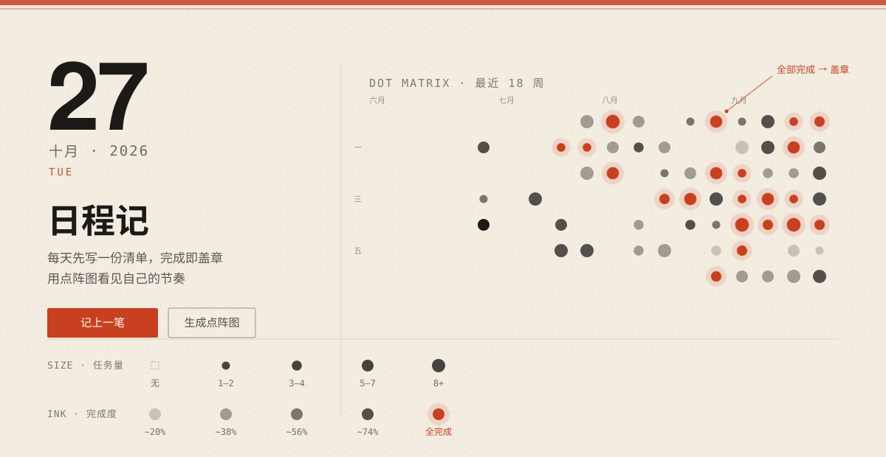

<div align="center">

# 日程记 · 点阵台账

**每天先写一份待办清单，完成即盖章，用点阵图看见自己的节奏。**

[](LICENSE)
[](index.html)
[](scripts/main.js)
[](https://ibarryyan.github.io/todo-matrix/)

[**在线试用 →**](https://ibarryyan.github.io/todo-matrix/)

</div>

---

## 它解决什么问题

待办应用通常只回答"今天还剩几件事"。它不回答另一个更重要的问题——**过去三个月，我到底做到了多少。**

这个应用每天给你一张纸。你往上面记一笔（不是设置番茄钟，不是拖拽排序，只是记一笔），做完就盖章。日积月累，底部那张点阵图会显出你的节奏：哪几天是满的、哪几天躺平了、哪几天是全须全尾做完的。

**没有账号，没有云端，不联网。** 打开网页就能写。

---

## 核心：点阵图怎么读

这是整个项目唯一的设计重点。每一个点同时编码**两个维度**：

| 视觉通道 | 编码的信息 | 取值 |
|---|---|---|
| **点的直径** | 当天的任务量 | 5 档：11px → 20px（0 / 1–2 / 3–4 / 5–7 / 8+） |
| **点的墨色** | 当天的完成度 | 浅墨 → 深墨；**全部完成 = 朱红盖章点 + 印泥外晕** |

一天里所有事都做完，那颗点会亮成红色。这是整个应用唯一的奖励反馈——没有等级、没有连胜徽章，只有一颗被盖章的红点。



> 横向 18 周 × 纵向 7 天（周日起）。点任意一天可直接跳过去补记，未来日期不可选。

---

## 特性

| | |
|---|---|
| **每日清单** | 输入框回车即记录；可切到任意历史日期补记，或提前给未来排期 |
| **盖章完成** | 点方框切换状态，完成瞬间 620ms 缩放回弹 + 朱红删线从左扫过 |
| **点阵图** | 最近 18 周双通道编码；「生成点阵图」按钮重放对角扫过的生成动画 |
| **统计** | 今日完成数、完成度进度条、连续完成天数、本周完成率、累计盖章数 |
| **明暗主题** | 默认跟随系统，可手动切换并记忆 |
| **响应式** | 桌面双栏 / 平板单栏 / 手机输入区吸顶、点阵图横向滚动自动定位到本周 |
| **本地优先** | 数据存 localStorage，键名 `dotledger.v1`，不上传任何服务器 |

---

## 快速开始

**方式一：直接打开**

```bash
# 双击即可，无需构建、无需 npm install
open index.html
```

**方式二：起个本地服务**（推荐，字体和某些 API 行为更贴近线上）

```bash
python3 -m http.server 8080
# 然后访问 http://localhost:8080
```

**方式三：部署到你自己的服务器**（纯静态文件，任意 Web Server 均可）

```bash
scp -r ./* user@server:/var/www/html/todo/
```

Nginx 侧加一段即可：

```nginx
location /todo/ {
    alias /var/www/html/todo/;
    index index.html;
    try_files $uri $uri/ /todo/index.html;
}
```

---

## 目录结构

```
todo-matrix/
├── index.html            结构、语义地标
├── styles/
│   ├── tokens.css        设计令牌：颜色 / 字阶 / 间距 / 圆角 / 阴影 / 动效 + 暗色覆盖
│   ├── base.css          重置、氛围层（渐变网格 / 点阵底纹 / 颗粒噪点）、排版、焦点样式
│   └── components.css    报头 / 台账行 / 计分条 / 点阵图 / 响应式断点
├── scripts/
│   └── main.js           日期工具、状态管理、渲染、事件、主题（约 18KB，无框架）
└── LICENSE
```

要改配色，基本只需要动 `styles/tokens.css`——所有颜色、间距、时长都是 CSS 变量，组件层没有一个硬编码色值。

---

## 设计说明

**方向：工业实用 × 印刷账簿。** 暖纸底而非纯白（`#F2ECE1`）、暖调近黑而非纯黑（`#1C1A17`）、全站唯一强调色是印泥朱红（`#C8401F`）——朱红只留给两个动作：**记上一笔** 和 **盖章完成**。

字体分三条线：巨大日期数字用 Archivo Black，标题用思源宋体，所有数字用 IBM Plex Mono 等宽对齐。

**动效规格**

| 场景 | 时长 | 说明 |
|---|---|---|
| 页面入场（4 组错峰 90ms） | 640ms | `cubic-bezier(0.16,1,0.3,1)` |
| 新增任务行 | 320ms | 同上 |
| 盖章完成 | 620ms | 缩放到 1.34 再回弹，带 -7° 旋转 |
| 点阵图生成扫过 | 520ms | 按 `列×3 + 行` 计算延迟，形成对角线推进 |

全部动效在 `prefers-reduced-motion: reduce` 下关闭。

---

## 可访问性

- 正文对比度 **13.5:1**，弱化文字 **5.1:1**，朱红按钮配白字 **5.0:1**（实测计算，非目测）
- 所有交互元素 ≥ **44×44px**
- `:focus-visible` 2px 描边 + 2px 偏移，键盘操作永远可见
- 每个点阵格子是真 `<button>`，带完整 `aria-label`（例："10月27日 · 5 项，完成 3 项"）
- 状态变更经 `role="status" aria-live="polite"` 播报
- **完成态不只靠颜色**：删线 + 方框填充 + ARIA 三通道冗余表达

---

## 数据存在哪儿

浏览器 localStorage。这意味着：

- ✅ 没人能读到你的清单，包括我
- ❌ 换浏览器 / 清缓存，数据不跟随

手动备份，在浏览器控制台执行：

```js
// 导出
copy(localStorage.getItem('dotledger.v1'))
// 导入（粘回 JSON 后）
localStorage.setItem('dotledger.v1', '<JSON>')
```

> 如果要多设备同步，需要自己加后端。这是刻意的取舍——没有后端，就没有用户信息可以漏。

---

## 已知限制

- 任务是纯文本，没有子任务、优先级、提醒、重复任务
- 没有数据导出按钮（见上文的控制台方案）
- 依赖 Google Fonts CDN；加载失败时回退到 PingFang SC / Songti SC 等系统字体，版式不崩
- 点阵图回溯 18 周，更早的记录不会显示

这些都是有意为之——它想做一张**纸**，不是一个项目管理工具。

---

## 贡献

欢迎 issue 和 PR。几条约定：

1. 改动请先开 issue 描述场景，避免重复劳动
2. 新增颜色必须写进 `tokens.css` 的变量，不要在组件层硬编码
3. 新增动效必须同时在 `prefers-reduced-motion` 分支里关闭
4. 保持零依赖

---

## License

[MIT](LICENSE) © 2026 ibarryyan

> 这是一个由 AI Agent 辅助构建的项目，设计方向与代码均由人工review 确认。
